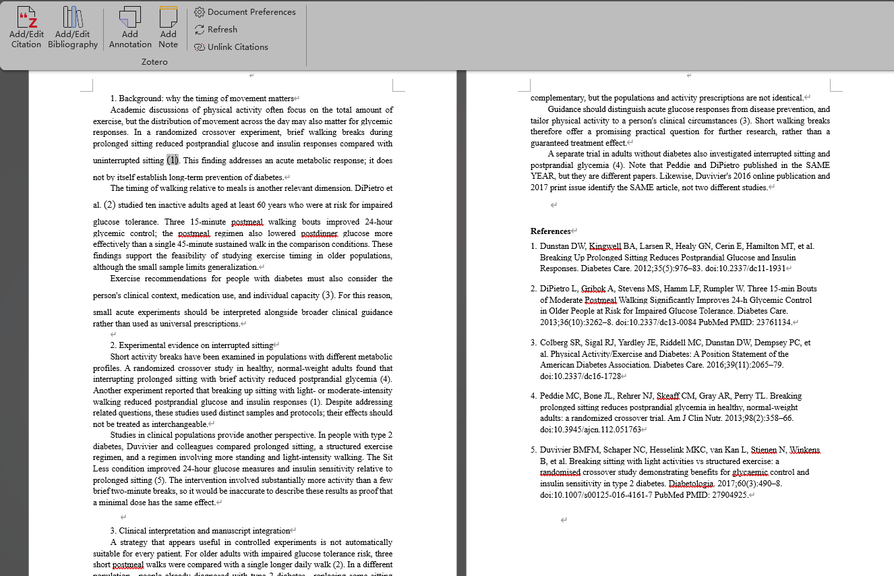
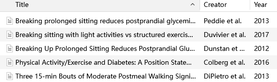
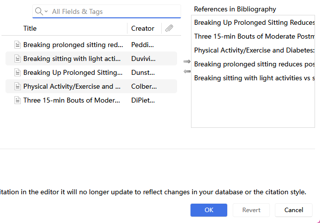
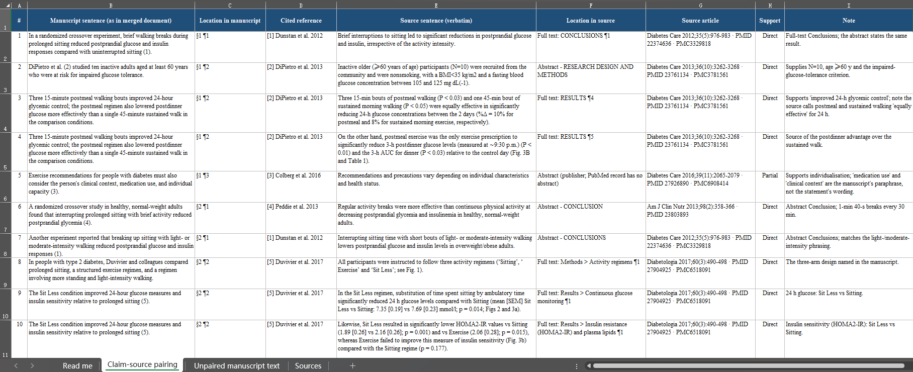
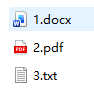
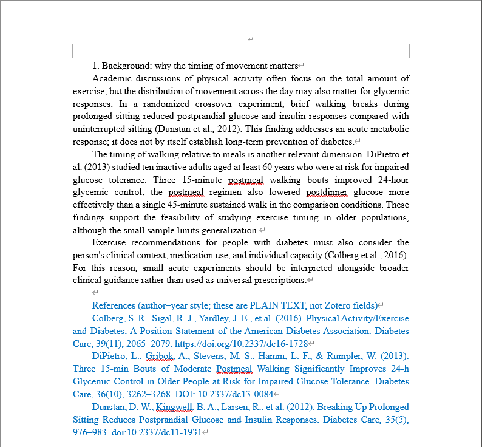
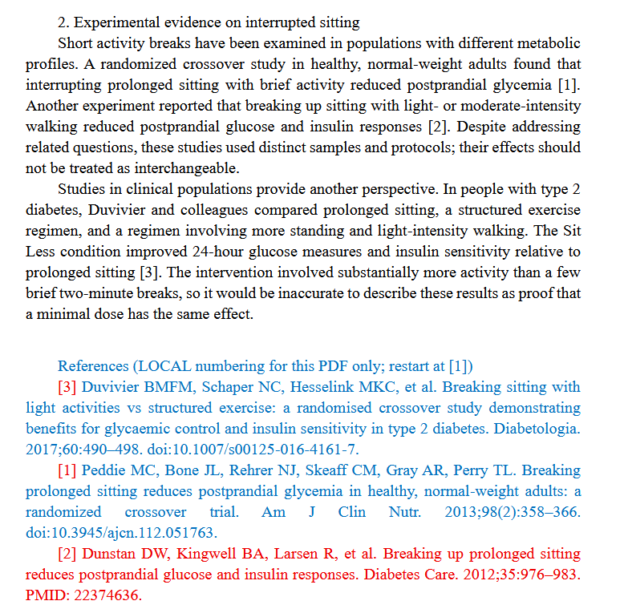
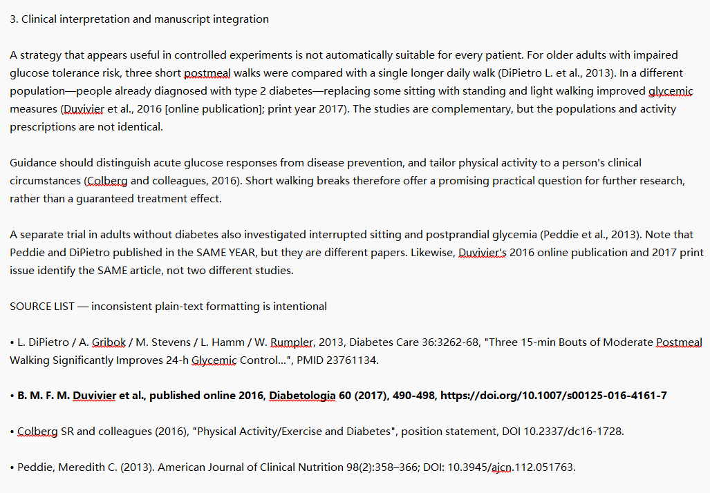
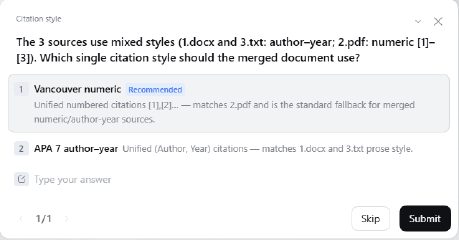

# Zotero RefFlow

### The last missing piece in AI-assisted academic writing.

**Your AI can write the paper. But can you still edit its citations?**

AI agents are great at finding papers and drafting sections. But the result often arrives as **separate documents, plain-text citations, restarted numbering, and duplicate references**. **Zotero RefFlow** connects those drafts to your own research workflow: merge the sections, reconcile references, and produce an **editable Word manuscript with native Zotero citations**.

Two independent Agent Skills: **Zotero Input** finds, checks, and imports references; **Zotero Output** turns citation-bearing drafts into a consistent manuscript. Use them separately or alongside your favorite academic-writing Skill.

[English](README.md) · [简体中文](README.zh-CN.md) · [See the live test](#real-test-three-formats-one-zotero-manuscript) · [Quick start](#quick-start)

## One workflow, from multiple agents to one manuscript

```text
Any academic-writing Agent / Skill
         │
     Cited drafts from different agents
         DOCX · PDF · TXT
         │
         ▼
    Zotero Output ─── Zotero Input (as needed)
    Merge · Match       Find · Verify · Import
    Deduplicate         Reuse library items
         │
         ├── Editable Word manuscript with Zotero-native citations
         ├── References in Zotero (optionally a collection)
         └── Optional citation–source evidence report
```

**Why native Zotero citations matter:** edit an in-text citation in Word, change the citation style, add or remove references, and refresh the bibliography through Zotero—not by manually rebuilding numbers and reference lists.

| Skill | What you can do | Guide |
| --- | --- | --- |
| **Zotero Input** | Extract a paper's bibliography, identify and check references, reuse existing Zotero records, import missing ones into a collection, and optionally check whether cited evidence supports a sentence | [Input](zotero-input/README.md) |
| **Zotero Output** | Combine already-cited sections, resolve mixed citation styles and duplicates, create a unified DOCX with native Zotero fields, and optionally produce a sentence–citation audit | [Output](zotero-output/README.md) |

## Real test: three formats, one Zotero manuscript

**The scenario.** Three AI-style manuscript sections about **postmeal walking, interrupted sitting, and glycemic control**, deliberately prepared with conflicting citation conventions:

| Input | Citation format | Designed challenge |
| --- | --- | --- |
| `1.docx` | Author–year | Bibliography not in citation order |
| `2.pdf` | Local `[1]`, `[2]`, `[3]` numbering | Numbers restart, reference list is out of order |
| `3.txt` | Mixed author names, DOI/PMID and years | Repeated works; a 2016-online / 2017-print paper |

**The task.** Merge the three sections in order; use **Vancouver numeric citations**; organize matching references in a Zotero collection; and generate a **claim–source evidence table** with source quotations, locations, and support judgments.

This run was performed in **a different Agent harness from the original Codex workflow**, using **DeepSeek V4.1 Flash (High)**. The full-text evidence comparison was enabled, which makes the task more token-intensive than a straightforward merge.

### Result 1 — A unified, editable Word manuscript

The output preserves all three sections, replaces the conflicting source citation schemes with one global sequence, and contains **five distinct references**.

[](assets/demo/merged-file.png)

### Result 2 — Zotero recognizes and edits the bibliography

The five works appear in Zotero. In Word, **Add/Edit Bibliography** opens the Zotero bibliography editor with the five referenced works—demonstrating that the generated bibliography is connected to Zotero's native editing workflow.



[](assets/demo/zotero-bibliography.png)

### Result 3 — A traceable claim–source evidence table

The generated sheet pairs manuscript claims with **original-source quotations, source locations, article identifiers, and support judgments**. In the ten visible examples, nine are marked **Direct** and one **Partial**, showing that the report distinguishes different levels of support.

[](assets/demo/citation-evidence-review.png)

<details>
<summary><strong>View the test inputs and format-selection step</strong></summary>

**Three input types**



**1. Word draft: author–year citations**



**2. PDF draft: local numeric references**



**3. TXT draft: mixed source descriptions**



**The Agent asks which citation style to use**



</details>

**Reproduce this test:** the original three passages, a fourth optional stress-test passage, and preparation instructions are in [the demo-case folder](demo-case/README.md).

## Quick start

### Install from GitHub Releases (or ask your Agent)

Download **Zotero Input** and/or **Zotero Output** from this repository's **Releases** page. Each Skill is distributed as a separate ZIP and can be installed independently.

**Copy to an Agent with GitHub and local-file access:**

> Find the official GitHub **Zotero-RefFlow-Skills** repository and open its Releases page. Download the latest `zotero-input` and `zotero-output` ZIP assets, extract them, and install each complete Skill folder in this Agent's supported Skills directory. Read each `SKILL.md`, set up the declared dependencies, and run the environment checks. Tell me when they're ready to use.

**Combine with an academic-writing Skill:**

> Install an academic-writing Skill supported by this Agent and the two Zotero RefFlow Skills. Have the writing Skill create sections with identifiable citations. Use Zotero Output to merge them, reuse Zotero library items, and create a Word manuscript with native Zotero citations. Use Zotero Input to check or import any missing sources into a collection. Add an original-source evidence report only when requested.

### Codex setup

Extract the complete Skill folders into `~/.codex/skills/` or `$CODEX_HOME/skills/`. **Python 3.10+** is required. In the `zotero-output/` directory:

```sh
python -m pip install -r requirements.txt
python -X utf8 -B scripts/zotero_output.py doctor
```

**Tip:** Keep **Zotero Desktop open when running Zotero Input**, particularly while matching references, importing records, or organizing a collection. Input uses Zotero's local API/Connector. For dynamic Word references, use Microsoft Word with the Zotero plugin.

### Prompts you can reuse

**Merge first (lighter workflow)**

> Use `zotero-output` to merge these DOCX, PDF, and TXT sections in order. Match existing plain-text citations, reuse records in Zotero, deduplicate repeated works, unify the citations in Vancouver style, and produce an editable Word document with Zotero-native references. No original-source evidence check for this run.

**Enable source verification (more tokens)**

> Also generate a claim–source evidence report. For each cited claim, include the matching reference, the source quotation and its location, and a Direct/Partial/Unsupported support judgment. Keep the report separate from the manuscript.

**Import a paper's whole reference list**

> Use `zotero-input` to extract and identify all references from the attached paper's bibliography. Reuse existing Zotero entries; import missing records into a new collection, and organize them there. Optionally examine the paper's in-text citations against their cited sources.

### Suggested Codex model settings

| Task | Suggested model |
| --- | --- |
| Merge and normalize already-cited sections | **GPT-6.1-Sol · Medium** reasoning |
| Check claims against original papers | **GPT-6.1-Sol · High** reasoning or above |

These are practical workflow recommendations. The demo above ran on **DeepSeek V4.1 Flash (High)** in another Agent harness.

## Requirements and maintenance

**Output** starts from a manuscript with identifiable existing citations or bibliographic information. PDF extraction and scanned-document OCR requirements are covered in the individual Skill guides. Zotero-native Word citation editing uses the Zotero desktop library and Word plugin; static DOCX/Markdown output is also supported.

The two Skills can be installed, packaged, and updated separately. Version information is recorded in [`versions.json`](versions.json). From the repository root:

```sh
python tools/package_skills.py --skill zotero-input
python tools/package_skills.py --skill zotero-output
```

Run isolated tests:

```sh
python -X utf8 -B -m unittest discover -s zotero-input/scripts -p "test_*.py" -v
python -X utf8 -B -m unittest discover -s zotero-output/scripts -p "test_*.py" -v
```

## License and attribution

Licensed under [Apache License 2.0](LICENSE). Copyright 2026 The Zotero-RefFlow-Skills Authors.

Zotero is a registered trademark of the Corporation for Digital Scholarship. This project is independent of, and not affiliated with, endorsed by, or sponsored by Zotero or the Corporation for Digital Scholarship.

Thanks to [Yuan1z0825](https://github.com/Yuan1z0825) and contributors to [nature-skills](https://github.com/Yuan1z0825/nature-skills). Zotero Input adapts literature-search and export scripts from that project's `nature-citation` (Apache-2.0). See [NOTICE](NOTICE) and the [upstream provenance record](zotero-input/references/bundled-search.md).
