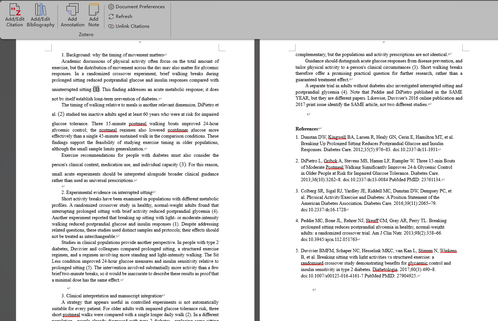
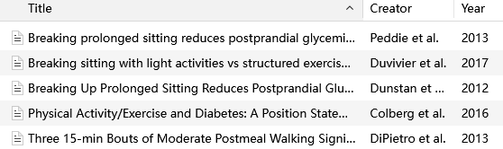
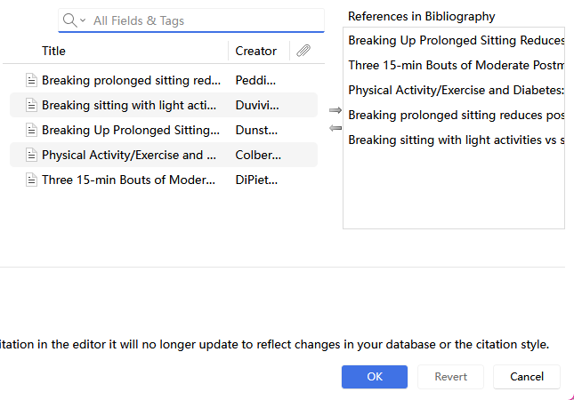
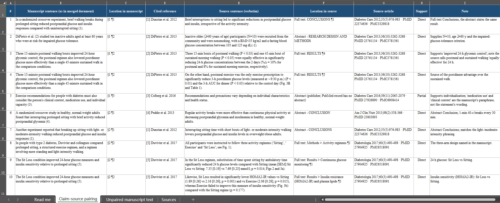
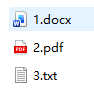
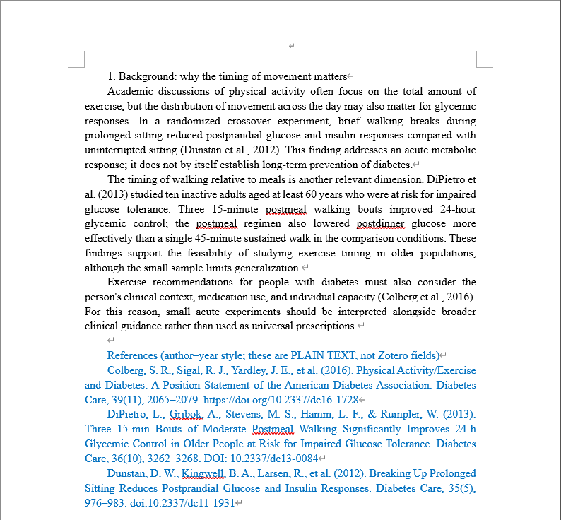
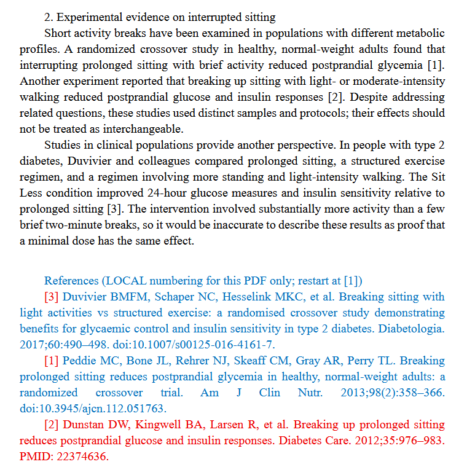
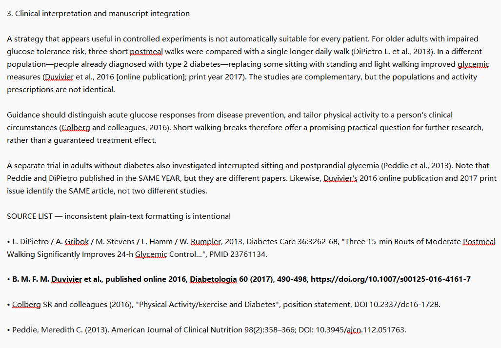
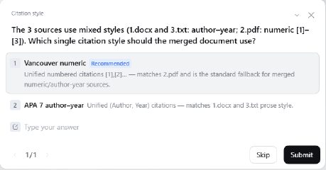

# Zotero RefFlow

### AI 辅助学术写作的最后一块拼图。

**AI 已经替你写好了论文，但你还能方便地修改其中的引文吗？**

AI Agent 已经可以查阅文献、撰写章节，却常常留下**分散的 Word / PDF / TXT 文稿、纯文本引用、混乱的编号和重复文献**。**Zotero RefFlow** 将这些草稿接入你真正使用的学术写作流程：整合章节、匹配和去重参考文献，生成**带 Zotero 原生动态引文的可编辑 Word 手稿**。

两项可独立使用的 Agent Skill：**Zotero Input** 负责文献识别、核验与导入；**Zotero Output** 负责将已有引用的文稿整合为一篇完整文章。可以分别使用，也能与其他论文写作 Skill 配合。

[English](README.md) · [简体中文](README.zh-CN.md) · [真实测试](#真实测试三种格式整合为一篇-zotero-手稿) · [快速开始](#快速开始)

## 让多个 AI 的草稿，成为一份可以继续编辑的手稿

```text
任意论文写作 Agent / Skill
         │
    不同 Agent 生成的已引用章节
         DOCX · PDF · TXT
         │
         ▼
   Zotero Output ─── 按需调用 Zotero Input
   合并 · 匹配         识别 · 核验 · 导入
   去重 · 统一编号      复用已有文献
         │
         ├── 含 Zotero 原生动态引文的 Word 手稿
         ├── Zotero 文献库（可指定 collection）
         └── 可选：句子—原文证据核验表
```

**为什么要保留 Zotero 原生引用？** 因为你可以在 Word 中用 Zotero 插件编辑引文、切换引用格式、增删文献，并自动刷新参考文献列表，不需要手动重新编号。

| Skill | 解决什么问题 | 详细说明 |
| --- | --- | --- |
| **Zotero Input** | 提取整篇论文的参考文献列表、识别和核验来源、复用 Zotero 已有文献，将缺失条目导入指定 collection；还可以按需核对文中引文 | [Input 文档](zotero-input/README.md) |
| **Zotero Output** | 整合已经带引用的不同章节，统一引用风格与文献顺序、去重，输出包含 Zotero 原生动态引文的 DOCX，并按需生成核对表 | [Output 文档](zotero-output/README.md) |

## 真实测试：三种格式整合为一篇 Zotero 手稿

**测试场景：** 以“**餐后步行、打断久坐与血糖控制**”为主题，故意将三段带真实参考文献的文本制作成不同格式，并制造引用不统一的情况：

| 输入 | 引用方式 | 设置的难点 |
| --- | --- | --- |
| `1.docx` | 作者—年份制 | 文末参考文献顺序打乱 |
| `2.pdf` | 局部 `[1]`、`[2]`、`[3]` 编号 | 章节编号重新开始，书目顺序不一致 |
| `3.txt` | 混合作者写法、DOI/PMID 和年份 | 重复文献；同一篇文章在线发表 2016 年、正式刊期 2017 年 |

**任务要求：** 按顺序合并三个文件，统一为 **Vancouver 顺序编码格式**，把匹配文献整理到 Zotero collection，并生成包含**原文引句、原文位置与支持性判断**的证据核验表。

为了测试不同 Agent 平台的适用性，这次从原来的 Codex 换到了**另一套 Agent Harness**，使用 **DeepSeek V4.1 Flash（High）**完成。此次开启了逐句原文核验，比单纯整合文稿的 Token 消耗更高。

### 成果一：一份可编辑、引用编号统一的 Word 手稿

三部分文本按顺序整合，原先混乱的引用转换成一套全局顺序编号，参考文献最终为 **5 篇不同的文章**。

[](assets/demo/merged-file.png)

### 成果二：在 Word 中用 Zotero 原生功能管理书目

五篇文献出现在 Zotero 中；在 Word 点击 **Add/Edit Bibliography** 后，Zotero 原生书目编辑器能识别并显示这五篇文献。



[](assets/demo/zotero-bibliography.png)

### 成果三：附带原文位置与支持性判断的核验表

生成的 Excel 表将**手稿句子、原文引句、原文位置、来源文章和支持性判断**逐项对应。截图显示的 10 条对应记录中，9 条标记为 **Direct**，1 条标记为 **Partial**，有助于作者快速定位需要进一步核对的表述。

[](assets/demo/citation-evidence-review.png)

<details>
<summary><strong>展开查看：三份原始文件及格式确认步骤</strong></summary>

**三种输入格式**



**1. Word：作者—年份制引用**



**2. PDF：各自独立的数字编号引用**



**3. TXT：混合书目信息与年份差异**



**Agent 询问统一后的引文格式**



</details>

**想自己跑一遍？** 三段原始测试文本、可选第四段压力测试，以及文件制作说明，都放在 [demo-case](demo-case/README.md)。

## 快速开始

### 从 GitHub Releases 下载，或直接让 Agent 帮你安装

两个 Skill 已分别发布为本仓库 **Releases** 页面中的 ZIP 附件，可以单独下载、安装和更新。

**复制给具备 GitHub 和本地文件访问权限的 Agent：**

> 找到 GitHub 官方 **Zotero-RefFlow-Skills** 仓库，打开 Releases 页面，下载最新的 `zotero-input` 和 `zotero-output` 两个 ZIP 包。解压后把完整 Skill 文件夹放到当前 Agent 支持的 Skills 目录，阅读各自的 `SKILL.md`，安装所需依赖，并运行环境检查。完成后告诉我安装结果。

**与其他论文写作 Skill 组合：**

> 安装当前 Agent 支持的论文写作 Skill，再安装 Zotero RefFlow。先用写作 Skill 生成带可识别引文的不同章节，再让 Zotero Output 合并、去重、复用 Zotero 库中已有条目，并生成含原生动态引用的 Word 文稿。用 Zotero Input 核验和补录缺失文献。仅当我提出要求时才进行逐句原文证据核对。

### Codex 安装

把完整解压后的两个 Skill 文件夹放到 `~/.codex/skills/`，或自定义的 `$CODEX_HOME/skills/` 目录。需要 **Python 3.10+**。在 `zotero-output/` 目录下运行：

```sh
python -m pip install -r requirements.txt
python -X utf8 -B scripts/zotero_output.py doctor
```

**使用建议：运行 Zotero Input 时，最好提前打开 Zotero Desktop 并保持运行**，尤其是导入、复用文献或整理 collection 时。Input 使用本地 API/Connector；Word 动态引文需配合 Zotero Word 插件。

### 常用提示词

**只整合文稿（相对省 Token）**

> 使用 `zotero-output`，按附件顺序合并这三个 DOCX、PDF、TXT 文件。匹配现有纯文本引文，优先复用 Zotero 库中的文献，合并重复条目，统一为 Vancouver 顺序编码格式，输出含 Zotero 原生引用的可编辑 Word。本次不进行逐句原文核验。

**开启原文证据核验（Token 消耗较高）**

> 另外生成一份句子—原文证据核验表，每条记录包含对应的参考文献、原文引句、位置，以及 Direct / Partial / Unsupported 支持性判断，并与最终稿件分开保存。

**把整篇论文的参考文献导入 Zotero**

> 使用 `zotero-input`，提取这篇文章文末的全部参考文献，核对书目信息，复用 Zotero 已有条目，将缺失的文献导入一个新建 collection。还可以按需核对文章中的引文是否支持相应论述。

### Codex 模型配置建议

| 任务 | 建议模型配置 |
| --- | --- |
| 仅合并章节、整理已有引文 | **GPT-6.1-Sol · 中等思考强度** |
| 对照原始文献核对论断 | **GPT-6.1-Sol · 高思考强度及以上** |

这是实用工作流建议。本页的实际演示使用的是另一套 Agent Harness 中的 **DeepSeek V4.1 Flash（High）**。

## 运行要求与维护

**Output** 处理的是已经存在可识别引文或文献列表的稿件。PDF、扫描件的文本提取/OCR 要求见各 Skill 文档；Zotero 原生动态引文需要 Zotero Desktop 与 Word 插件，也支持静态 DOCX/Markdown 输出。

两项 Skill 可分别安装、打包与更新。版本信息见 [`versions.json`](versions.json)。在仓库根目录分别打包：

```sh
python tools/package_skills.py --skill zotero-input
python tools/package_skills.py --skill zotero-output
```

分别执行测试：

```sh
python -X utf8 -B -m unittest discover -s zotero-input/scripts -p "test_*.py" -v
python -X utf8 -B -m unittest discover -s zotero-output/scripts -p "test_*.py" -v
```

## 许可与致谢

项目采用 [Apache License 2.0](LICENSE)。Copyright 2026 The Zotero-RefFlow-Skills Authors。

Zotero 是 Corporation for Digital Scholarship 的注册商标。本项目是独立 Skill 集合，与 Zotero 项目及该机构不存在隶属、背书或赞助关系。

感谢 [Yuan1z0825](https://github.com/Yuan1z0825) 及 [nature-skills](https://github.com/Yuan1z0825/nature-skills) 的贡献者。Zotero Input 中的文献检索与导出脚本改编自该项目的 `nature-citation`（Apache-2.0）；详见 [NOTICE](NOTICE) 与 [上游来源记录](zotero-input/references/bundled-search.md)。
